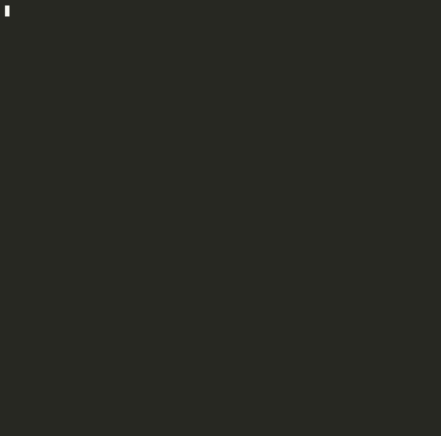

<div align="center">

# Make Me Unicorn

**Catch what AI-generated SaaS code misses — before it costs you users, money, or trust.**

The open-source launch checklist and operating system for solo builders.

[](./LICENSE)
[](https://pypi.org/project/make-me-unicorn/)
[](https://pypi.org/project/make-me-unicorn/)
[](./SPEC.md)
[](./.github/workflows/mmu-guardrails.yml)
[](./CONTRIBUTING.md)

**English** · [🇰🇷 한국어](./README.ko.md) · [🇯🇵 日本語](./README.ja.md) · [🇨🇳 简体中文](./README.zh-CN.md) · [🇪🇸 Español](./README.es.md)




</div>

## 60-Second Demo

```bash
pip install make-me-unicorn   # or zero-install: uvx make-me-unicorn
cd your-project
mmu init && mmu scan && mmu
```

```text
  MAKE ME UNICORN - STATUS DASHBOARD

          .--*--.
         / *v*  \
        |       |
         \ ___ /
          '---'

  Stage: HATCHING    ######..............  22%  (124/551)

  LAUNCH GATES  (16/26)
    M0 Problem Fit         ################   4/4   PASS
    M1 Build Fit           ################   5/5   PASS
    M2 Revenue Fit         ############....   3/4   OPEN
    M3 Trust Fit           ################   4/4   PASS
    M4 Growth Fit          ########........   2/4   OPEN
    M5 Scale Fit           ####............   1/5   OPEN
```

Your unicorn evolves as you build: **Egg → Hatching → Foal → Young → Unicorn → Legendary.**

## Add a Badge to Your README

Show your launch readiness to the world. One command:

```bash
mmu badge                          # get markdown badge
mmu badge --format svg -o badge.svg  # save as SVG file
mmu badge --format endpoint -o badge.json  # self-updating badge (shields.io endpoint)
mmu badge --clipboard              # copy to clipboard
```

For a badge that stays live, publish `badge.json` at a raw URL (commit it, or push it to Pages) and embed `https://img.shields.io/endpoint?url=<raw-url>` — regenerate the JSON in CI and the badge updates itself.

Then paste in your README:

[](https://github.com/minjikim89/make-me-unicorn)

*Every badge links back here. Every README becomes a growth channel.*

## Share Your Score

```bash
mmu share                     # print shareable score card
mmu share --clipboard         # copy to clipboard (macOS)
```

```
┌─────────────────────────────────────────────┐
│  Make Me Unicorn — Launch Readiness         │
│                                             │
│  Score: 68%  Stage: YOUNG UNICORN           │
│                                             │
│  M0 Problem Fit    ████████████████  PASS   │
│  M1 Build Fit      ████████████████  PASS   │
│  M2 Revenue Fit    ██████████░░░░░░  OPEN   │
│  M3 Trust Fit      ████████████████  PASS   │
│  M4 Growth Fit     ████████░░░░░░░░  OPEN   │
│  M5 Scale Fit      ████░░░░░░░░░░░░  OPEN   │
│                                             │
│  Stack: Next.js · Stripe · SSR              │
│  pip install make-me-unicorn                │
│  github.com/minjikim89/make-me-unicorn      │
│  #MakeMeUnicorn                             │
└─────────────────────────────────────────────┘

Check your SaaS launch readiness:
https://github.com/minjikim89/make-me-unicorn
```

## The Problem

You code with AI. You ship fast. But then:

| What goes wrong | What it costs you |
|-----------------|-------------------|
| Forget password reset while building login | Users locked out on day 1 |
| Skip webhook signature verification | Attackers replay payment events |
| Launch without OG tags | Every shared link looks broken |
| Lose context between AI sessions | Re-explain your project from scratch |
| No refund policy | First dispute = frozen Stripe account |

**You're not failing at coding. You're failing at tracking what matters.**

## What MMU Covers

<table>
<tr>
<td width="33%">

**Building**
- Frontend (responsive, a11y, forms)
- Backend (API, DB, queues)
- Auth (login, reset, OAuth, sessions)
- Billing (Stripe, webhooks, refunds)
- Testing (unit, E2E, agent safety)

</td>
<td width="33%">

**Launching**
- SEO (OG tags, sitemap, meta)
- Legal (privacy, terms, GDPR)
- Security (CORS, rate limits, secrets)
- Performance (caching, lazy load)
- CI/CD (pipeline, rollback plan)

</td>
<td width="34%">

**Operating**
- Monitoring (errors, uptime, alerts)
- Analytics (funnel, retention, events)
- Email (transactional, templates)
- Accessibility (WCAG, keyboard nav)
- Reliability (backup, incident plan)

</td>
</tr>
</table>

**670+ items. 15 categories. 6 launch gates. Zero guesswork.**

## How Is MMU Different?

| | Scope | Lives where | Agent-native | Tracks progress |
|---|---|---|---|---|
| **MMU** | Full SaaS: code + billing + legal + growth + ops | Your repo, plain markdown | ✅ Claude plugin + MCP server | ✅ Score, gates, evolving dashboard |
| Lighthouse | Frontend performance/a11y/SEO only | Browser/CI | ❌ | Per-run score, no project memory |
| Vendor launch checklists (Vercel, Stripe docs) | One vendor's slice | Their docs site | ❌ | ❌ Read-only |
| Static checklist repos / Notion templates | Varies, usually unverifiable | Copy-paste | ❌ | ❌ Manual, goes stale |
| AI code reviewers (CodeRabbit etc.) | Code diffs | PR workflow | Partially | Per-PR, no launch view |

MMU is not a linter and not a docs site — it's the **operating layer between your AI coding sessions and an actual launch**: a verifiable checklist your CLI, CI, and AI agents all read and update.

## Vibe Check Your AI-Generated Code

One command scans for the gaps AI assistants miss most — the ones that show up in real scans of shipped vibe-coded apps, not a generic linter list:

```bash
mmu vibecheck
```

```text
Vibe check — what AI-generated code usually misses

  ✗ (P0) secrets: possible hardcoded secrets in 1 file(s): Stripe live secret key
  ✗ (P0) webhook-signature: webhook handlers found but no signature verification markers
        ↳ Verify provider signatures or attackers can forge payment events.
  ✗ (P0) password-reset: auth code detected but no password reset flow markers
        ↳ The #1 day-one lockout: users who can log in but can never get back in.
  ⚠ (P1) rate-limiting: server framework detected but no rate limiting markers

Vibe check result: 3 launch-blocking issue(s), 1 warning(s)
```

Checks: hardcoded secrets · unignored `.env` · webhook signature + idempotency · password reset flow · f-string SQL · unsafe Python deserialization · rate limiting · wildcard CORS · `DEBUG = True` · error monitoring · secrets behind `NEXT_PUBLIC_`/`VITE_` prefixes · Supabase tables without RLS · production source maps · command-executing `.git/config` keys. P0 findings exit non-zero, so it drops straight into CI.

The newest checks come straight from what is actually broken in the wild. [Reeve's August 2026 scan](https://vibe-eval.com/updates/vibe-coding-security-monthly-aug-2026/) of 30,998 live vibe-coded apps found **57% of Supabase-backed apps allowed unauthenticated table reads** (no RLS), **1 in 23 shipped a secret in the public bundle**, and **13% published source maps**. Every finding prints a `why:` link to the incident report or dataset behind the rule, so you can judge the risk yourself instead of trusting a scanner. Findings whose files all live in test directories (`tests/`, `__tests__/`, `fixtures/`, …) or test-suffixed files (`*.test.ts`, `test_*.py`) are downgraded to warnings — fake keys in fixtures should not block your build. Monorepos are covered: `.env*` files, build configs, and `supabase/` directories are found up to three levels deep.

### Run It in GitHub Actions

One step in any workflow — launch-blocking findings fail the build:

```yaml
- uses: minjikim89/make-me-unicorn@main
  # optional:
  # with:
  #   root: "apps/web"        # subfolder to scan
  #   version: "==0.9.0"      # pin a release
```

## Personalize Your Checklist

Not every project needs billing or i18n. MMU adapts:

```bash
mmu init                      # generates .mmu/config.toml
```

```toml
[features]
billing = false               # no Stripe? billing items won't count against you
i18n = false

[architecture]
framework = "nextjs"
```

Your score reflects **only what applies to your project**. `mmu status --why` shows the breakdown — like Lighthouse, but for SaaS readiness.

## 6 Launch Gates

Phase exits. Don't skip ahead.

```
M0 Problem Fit    →  Do you know WHO and WHY?
M1 Build Fit      →  Does the core product work end-to-end?
M2 Revenue Fit    →  Can someone pay you? And get a refund?
M3 Trust Fit      →  Privacy policy? Support path? Logging?
M4 Growth Fit     →  Will links look right? Can people find you?
M5 Scale Fit      →  What happens at 3am?
```

Run `mmu gate --stage M0` to verify.

## 12 Operating Modes

One mode per session. Each loads only the docs you need — prevents the #1 problem with AI coding: **context overload**.

```bash
mmu start --mode backend      # loads: architecture.md, sprint, ADR logs
mmu start --mode billing      # loads: pricing.md, billing checklist, compliance
mmu start --mode growth       # loads: SEO checklist, metrics
```

## AI Integration (Optional)

MMU works without AI. But with Claude, it gets powerful:

```bash
pip install make-me-unicorn[llm]
export ANTHROPIC_API_KEY=sk-ant-...
```

| Command | What happens |
|---------|-------------|
| `mmu init --interactive` | Answer 5 questions → Claude writes your strategy, product, pricing, architecture, and UX docs |
| `mmu start --mode X --agent` | Auto-formats session context for Claude Code or any LLM |
| `mmu doctor --deep` | Claude reads your code, flags mismatches, security gaps, blind spots |
| `mmu generate strategy` | Generates or updates core docs based on current project state |

Core CLI stays zero-dependency. AI features degrade gracefully.

## Put the gate in your agent's loop

Agents skip optional tools, but they cannot skip a hook. `mmu install` registers `mmu vibecheck` as a hook in the agent you use, so a P0 finding stops the commit, the push, or a premature "done" while the agent can still fix it.

```bash
pip install make-me-unicorn        # or use uvx; the installer then registers `uvx --from make-me-unicorn mmu hook`
mmu install --claude               # .claude/settings.json
mmu install --codex --cursor --gemini --git --agents-md --skill   # or: mmu install --all
mmu install --all --dry-run        # print the planned changes
mmu install --all --uninstall      # remove them again
```

| Host | Commit / push gate | "Not done yet" gate | Post-edit feedback | Config written |
|------|--------------------|---------------------|--------------------|----------------|
| Claude Code | PreToolUse (Bash) | Stop | PostToolUse (Edit, Write, MultiEdit) | `.claude/settings.json` |
| Codex CLI | PreToolUse (Bash) | Stop | PostToolUse (apply_patch) | `.codex/hooks.json` |
| Cursor | beforeShellExecution | stop | not available | `.cursor/hooks.json` |
| Gemini CLI | BeforeTool (run_shell_command) | AfterAgent | not available | `.gemini/settings.json` |
| git | pre-commit (chains an existing hook) | | | `.git/hooks/pre-commit` |
| pre-commit framework | hook id `mmu-vibecheck` | | | `.pre-commit-hooks.yaml` |

What the agent sees when a commit is blocked:

```text
mmu vibecheck: 2 launch-blocking issue(s) in /path/to/app — commit blocked.
mmu vibecheck: 2 blocking (P0), 0 warning(s) (P1), 0 suppressed | scope: changed (2 file(s))
P0 webhook-signature app/api/webhooks/stripe/route.ts:4
  what: webhook handlers found but no signature verification markers
  fix: Verify the provider signature on the raw request body before parsing or trusting the event; return 400 on failure. …
  silence (only if false positive): // mmu-ignore[webhook-signature]: <reason>
```

- The commit gate scans what the commit will contain: staged files, or all changed files for `git commit -a`, pathspecs, and `git add … && git commit …`. A push scans files changed since the upstream.
- The stop gate sends the agent back at most `MMU_STOP_MAX` times per session (default 3) and honours the host's own loop guard. `MMU_STOP_DISABLE=1` turns it off.
- If the scanner cannot run, the action goes through and one visible line says so. The gate never blocks on its own failure.
- Bypass one command with a `MMU_HOOK_DISABLE=1` prefix; set it in the agent's environment to disable all hooks. `MMU_HOOK_ON_PUSH_ONLY=1` gates only pushes.

### Claude Code plugin

```bash
# In Claude Code:
/plugin marketplace add minjikim89/make-me-unicorn
/plugin install make-me-unicorn --marketplace minjikim89/make-me-unicorn
```

The plugin registers the same three hooks from its bundled source (no `pip install`; needs `python3` 3.10+), the `mmu-vibecheck` skill, a `/vibecheck` command, and the MCP server (started with `uvx`, so it needs [uv](https://docs.astral.sh/uv/)). The `mmu-startup` skill (blueprints, idea validation, Product Hunt kit) is included for planning.

The `mmu-vibecheck` skill follows the Agent Skills spec. Codex and other hosts that read `.agents/skills/` pick it up from this repository, or from your project after `mmu install --skill`.

## MCP Server Mode

MMU also runs as an MCP (Model Context Protocol) server for any MCP client (Claude Code, Claude Desktop, Cursor, Gemini CLI, Codex). It works with MCP Python SDK v1 (1.27+) and v2.

```bash
uvx --from 'make-me-unicorn[mcp]' mmu serve-mcp     # zero-install
pip install 'make-me-unicorn[mcp]' && mmu serve-mcp # stdio transport (default)
```

Client config:

```json
{
  "mcpServers": {
    "make-me-unicorn": {
      "command": "uvx",
      "args": ["--from", "make-me-unicorn[mcp]", "mmu", "serve-mcp"]
    }
  }
}
```

Tools exposed (all read-only):

- `mmu_vibecheck(project_root, scope="all"|"changed"|"staged", format="json"|"agent")`: the launch gate. Structured output is the `mmu.vibecheck/v1` document
- `mmu_explain_rule(rule_id)` / `mmu_list_rules()`: what a rule detects and how to fix it
- `mmu_validate_idea(idea)`: check an idea against live HN + Reddit threads (network)
- `mmu_get_blueprint(name)` / `mmu_list_blueprints()`: launch checklists per area
- `mmu_list_idea_templates()`: start/close/ADR prompts + Product Hunt kit

`mmu_validate_idea` needs the `[validate]` extra for sentiment scoring; it is free mode only (no API keys).

## Validate an Idea

Pull real signal from HN + Reddit before you build:

```bash
pip install make-me-unicorn[validate]
mmu validate "AI tutor for kids" --limit 30
```

Default mode is **free** — no API keys, no paid calls. Public Reddit + HN Algolia search, local VADER sentiment, capitalized-token competitor surface. Saves a markdown report to `reports/validate/<slug>-<hash>.md`.

For a 1-page validation verdict synthesized from the threads:

```bash
mmu validate "AI tutor for kids" --llm
# Prompts for cost confirmation (~$0.05-0.20). Use -y to skip.
```

`--llm` is opt-in — the default flow never calls the Anthropic API.

## Full Command Reference

```bash
mmu                           # status dashboard
mmu init                      # bootstrap project
mmu init --interactive        # LLM-guided setup (5 questions → 5 docs)
mmu scan                      # auto-detect tech stack
mmu status --why              # score breakdown
mmu next                      # prioritized next actions
mmu show frontend             # drill into any category
mmu check frontend 3          # mark item done
mmu gate --stage M0           # verify gate readiness
mmu doctor                    # guardrail health checks
mmu doctor --deep             # LLM-powered semantic review
mmu vibecheck                 # scan for AI-generated code blind spots (secrets, webhooks, …)
mmu share                     # shareable score card
mmu badge                     # README badge (markdown/svg/html)
mmu start --mode backend      # start focused session
mmu close                     # end session with structured memory
```

## Who This Is For

| You are... | MMU helps you... |
|------------|------------------|
| **A founder coding with AI** | Stop re-explaining your project. Keep context across tools. |
| **A frontend developer** | Know exactly what to build: auth flows, error states, OG tags. |
| **A product manager** | Structured PRD, pricing strategy, launch checklist — all in markdown. |
| **A fullstack builder** | Track everything in one place. Nothing slips through. |

## Example: TaskNote

A fully filled-out example:

```
examples/filled/tasknote/
├── docs/core/strategy.md      ← ICP, value prop, competitors
├── docs/core/product.md       ← MVP scope, user journey, P0/P1
├── docs/core/pricing.md       ← Free/Pro/Team, billing rules
├── docs/core/architecture.md  ← Next.js + FastAPI + Postgres
├── docs/adr/001_billing_provider_choice.md  ← Why Stripe?
└── current_sprint.md          ← This week's 3 goals
```

## Requirements

- Python `3.10+`
- Core CLI: zero external dependencies
- AI features: `pip install make-me-unicorn[llm]`

## CI Guardrails

`mmu doctor` runs on every PR. `mmu gate` runs for stages listed in `docs/ops/gate_targets.txt`.

## Contributing

See `CONTRIBUTING.md`. Issues labeled [`good first issue`](https://github.com/minjikim89/make-me-unicorn/issues?q=is%3Aissue+is%3Aopen+label%3A%22good+first+issue%22) are scoped for a first PR — each one links the exact files to touch.

## Support the Project

If MMU caught something you would have missed, **[a star](https://github.com/minjikim89/make-me-unicorn/stargazers) helps other solo builders find it** — that's the whole growth model of this project.

[](https://star-history.com/#minjikim89/make-me-unicorn&Date)

## License

MIT. See `LICENSE`.

<!-- mcp-name: io.github.minjikim89/make-me-unicorn -->
